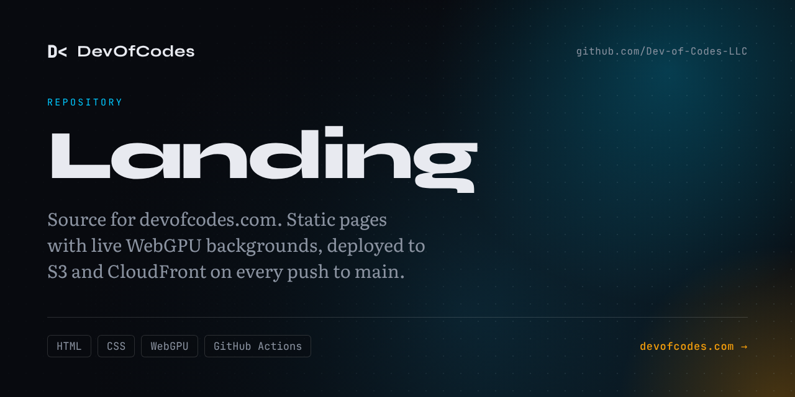

<a href="https://devofcodes.com"></a>

Source for [devofcodes.com](https://devofcodes.com), the site of DevOfCodes LLC. Plain HTML and CSS, no build step. Backgrounds are rendered live with WebGPU by the MIT [`shaders`](https://github.com/shader-effects-inc/shaders) library, with a CSS fallback under every surface. The code is MIT; the copy and images are © DevOfCodes LLC; third-party pieces keep their own licences. [`NOTICE.md`](NOTICE.md) says which is which.

## Layout

| Path | What it is |
|---|---|
| `index.html` | Home: intro, projects, work with me, contact |
| `about.html`, `changelog.html`, `open-editor.html` | About, the log, the Open Editor research plan |
| `privacy.html`, `terms.html` | Legal pages |
| `.well-known/security.txt` | Where to report a security problem ([RFC 9116](https://www.rfc-editor.org/rfc/rfc9116)). `Expires` is a year out: renew it before it lapses |
| `LICENSE.md`, `NOTICE.md` | MIT for the code, and what is not under it |
| `assets/site.css`, `assets/site.js` | Shared tokens, nav, reveals, contact form |
| `assets/shaders.js` | WebGPU presets, mounted lazily |
| `.github/workflows/deploy.yml` | Deploy to S3 and CloudFront |
| `.claude/skills/` | The `transitions-dev` and `transitions-polish` agent skills, copied from [transitions.dev](https://github.com/Jakubantalik/transitions.dev/tree/a0c6e7bbf603a0a46588e37c6c6a4d0af3290d52/skills) at commit `a0c6e7b`. Their licence files sit next to each `SKILL.md`. |
| `.github/brand/` | GitHub avatar, banner and social previews, and the templates that render them |

## Preview

```sh
npx serve -l tcp://127.0.0.1:4173 -l "tcp://[::1]:4173" -c .claude/serve.json .
```

The preview listens on loopback only. `.claude/serve.json` answers 404 for anything that is not a page, `assets/`, `.well-known/`, `favicon.ico`, `robots.txt` or `sitemap.xml`, so `.git`, `.claude` and other local files stay private even when `serve` falls back to another port on every interface because 4173 is taken. Add a new page's name, or any new top-level file, to that list.

## Deploy

Every push to `main` syncs the site to S3 and invalidates CloudFront (see `.github/workflows/deploy.yml`). `main` takes changes through pull requests only. Markdown files, `.github/` and `.claude/` are never uploaded. The role, bucket and distribution come from secrets on the repository's `prod` environment (`DEPLOY_ROLE_ARN`, `SITE_BUCKET`, `CLOUDFRONT_DISTRIBUTION_ID`), so the workflow names none of them.
